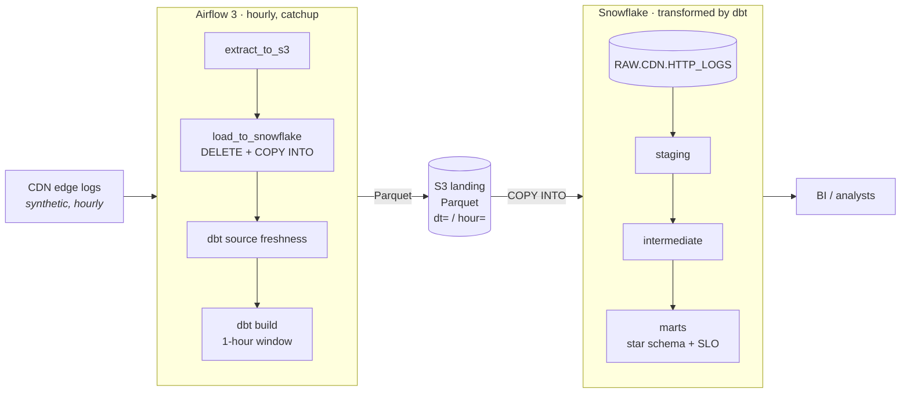
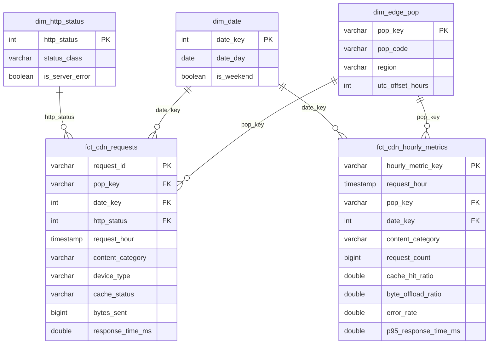
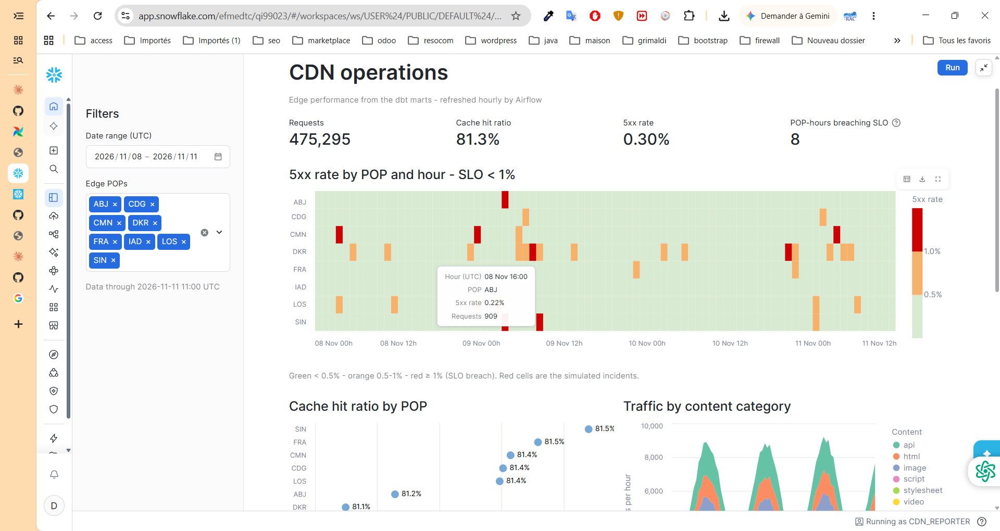

# CDN Metrics ELT — Airflow · dbt · Snowflake

[](https://github.com/Djewiet/cdn-elt-snowflake/actions/workflows/ci.yml)
[](https://djewiet.github.io/cdn-elt-snowflake/)


Production-style hourly ELT pipeline for CDN access logs. Airflow lands one
Parquet file per hour in S3, loads it into Snowflake with `COPY INTO`, and dbt
turns raw requests into a tested star schema that answers the questions a CDN
team asks every day: **what is our cache offload, where are errors coming from,
and is each edge POP meeting its latency SLO?**



CI on GitHub Actions lints and tests every change (Ruff, SQLFluff, pytest, DAG integrity), runs `dbt build` on DuckDB and on Snowflake in an isolated schema, and publishes the dbt docs to GitHub Pages.

## Highlights

| Concern | How it is handled |
|---|---|
| **Idempotency** | One DAG run = one hour. The source is deterministic per hour, the S3 key derives from the data interval, and the load runs `DELETE` + `COPY INTO … FORCE` in a single transaction. Retries and backfills never duplicate rows. |
| **Backfill** | `catchup=True`, `max_active_runs=4`, explicit `CronDataIntervalTimetable` (true 1-hour intervals). dbt receives the run's interval as vars, so each run rebuilds exactly its own hour, in any order. dbt runs are serialized through a 1-slot pool. |
| **Load correctness** | The load task compares `rows_loaded` returned by `COPY INTO` with the extracted row count and fails on any mismatch. Lineage columns (`_source_file`, `_loaded_at`) come from `INCLUDE_METADATA`. |
| **Modelling** | staging → intermediate → marts. Transaction fact (1 row/request), periodic snapshot fact (hour × POP × content category), conformed dimensions, daily SLO report. Incremental `delete+insert` with late-data lookback. |
| **Data quality** | 53 data tests: `unique`, `not_null`, `relationships`, `accepted_values`, `dbt_utils` range and expression tests, a singular reconciliation test (hourly snapshot = request fact) and a dbt **unit test** on classification rules. Source freshness gate in the DAG. |
| **Security** | RSA key-pair auth for Snowflake service users (`TYPE = SERVICE`), least-privilege roles (loader / transformer / reporter), S3 storage integration (no AWS keys in Snowflake), no secret in the repo. |
| **Cost control** | X-Small warehouse, 60 s auto-suspend, resource monitor that suspends at 10 credits/month. |
| **CI/CD** | Ruff, SQLFluff, pytest, DAG integrity tests, offline `dbt build` on DuckDB (runs on forks), `dbt build` on Snowflake in an isolated per-PR schema dropped afterwards, dbt docs published to GitHub Pages. |

## Data model



`rpt_pop_daily_health` rolls this up per day and POP and flags whether the SLO
held on every hour (5xx < 1 % and p95 < 500 ms).

**Source.** The pipeline ingests synthetic CDN edge logs from
[`src/cdn_logs`](src/cdn_logs/generator.py): 8 POPs (Casablanca, Abidjan,
Dakar, Lagos, Paris, Frankfurt, Ashburn, Singapore), diurnal traffic in each
POP's local time, Zipf-like object popularity, content-dependent cache hit
rates, log-normal latency and randomly injected incident hours. About 140 k
requests per day, so the marts show realistic patterns at trial-account cost.

## Quick start

### 1. Offline, in two minutes (no cloud account)

The same dbt project runs on DuckDB, which is how CI validates every PR.

```bash
make install       # venv + dbt packages + pre-commit
make local-build   # 72 h of logs into DuckDB, then dbt build (seeds, models, tests)
make lint test
```

### 2. Full pipeline on AWS + Snowflake

<details>
<summary><b>Step-by-step setup</b></summary>

1. **Keys** — `make keys` creates an RSA key pair per service user in `./secrets` (git-ignored) and prints the public keys.
2. **Snowflake** — in a [30-day trial](https://signup.snowflake.com/) worksheet, run [`snowflake/01_account_setup.sql`](snowflake/01_account_setup.sql) with the public keys pasted in.
3. **S3 + IAM** — `BUCKET=<name> REGION=<snowflake-region> ./scripts/aws_setup.sh bootstrap` creates the hardened bucket, the Airflow writer user and the role Snowflake assumes ([policies](snowflake/aws/landing-bucket-policies.md)). Run [`snowflake/02_landing_s3.sql`](snowflake/02_landing_s3.sql) with the printed values, then `./scripts/aws_setup.sh trust <STORAGE_AWS_IAM_USER_ARN> <STORAGE_AWS_EXTERNAL_ID>` with the output of `desc integration`, and `./scripts/aws_setup.sh verify`.
4. **Config** — `cp .env.example .env` and fill in the AWS keys, bucket, Snowflake account identifier, Fernet key and JWT secret.
5. **Run**
   ```bash
   make up     # build image, migrate metadata DB, start Airflow on :8080
   make seed   # load seeds and dimensions in Snowflake (once)
   ```
   Unpause `cdn_elt_hourly` in the UI: Airflow catches up from `CDN_START_DATE`.
   Explicit range: `make backfill FROM=2026-11-01T00:00:00 TO=2026-11-03T00:00:00`.
6. **CI secrets** — add `SNOWFLAKE_ACCOUNT`, `SNOWFLAKE_USER` (`SVC_CDN_TRANSFORMER`) and `SNOWFLAKE_PRIVATE_KEY` (PEM content) to the repository, and set Pages source to *GitHub Actions*.

</details>

## Dashboard

A Streamlit app running inside Snowflake ([`streamlit/app.py`](streamlit/app.py)) reads only the marts, as the read-only `CDN_REPORTER` role: KPI tiles, a POP × hour heatmap of 5xx rates against the 1 % SLO, cache hit ratio per POP, traffic by content type and the daily SLO report.



- **In Snowflake:** run [`snowflake/03_dashboard.sql`](snowflake/03_dashboard.sql), switch Snowsight to the `CDN_REPORTER` role, create a Streamlit app in `ANALYTICS.DASHBOARDS` on `CDN_WH` and paste `streamlit/app.py`.
- **Offline:** `make local-build && make dashboard-local` serves the same app on the DuckDB build.

## Screenshots

<!-- Add once captured:  -->
Live documentation and lineage graph: **[dbt docs](https://djewiet.github.io/cdn-elt-snowflake/)**.

## Repository layout

```
├── dags/cdn_elt_hourly.py        # Airflow 3 DAG (TaskFlow + assets)
├── src/cdn_logs/                 # source system: deterministic log generator + Parquet writer
├── dbt/
│   ├── models/staging/           # typing, renaming, dedup (views)
│   ├── models/intermediate/      # business classification (+ unit test)
│   ├── models/marts/             # star schema, incremental facts, SLO report, exposure
│   ├── macros/                   # incremental_window, schema naming, CI cleanup
│   ├── seeds/                    # edge POPs, HTTP status codes
│   └── tests/                    # singular reconciliation test
├── streamlit/app.py              # dashboard (Streamlit in Snowflake, or local on DuckDB)
├── snowflake/                    # RBAC, warehouse, resource monitor, stage, raw table, IAM, dashboard grants
├── tests/                        # pytest: generator + DAG integrity
├── scripts/load_local_duckdb.py  # offline raw layer for local dev and CI
├── .github/workflows/            # ci.yml, docs.yml
├── Dockerfile, docker-compose.yaml, Makefile
```

## Design notes

- **ELT, not ETL.** Raw data lands untouched in `RAW`; every transformation is versioned SQL in dbt, testable and documented.
- **Why delete+insert.** It rebuilds a whole time window atomically and behaves the same on Snowflake and DuckDB, which keeps the offline CI meaningful.
- **Why dbt in its own virtualenv.** Airflow and dbt pin conflicting dependencies; isolating dbt avoids breaking either on upgrade.
- **Explicit data intervals (an Airflow 3 pitfall).** In Airflow 3 a cron string maps to `CronTriggerTimetable`, whose data interval starts and ends at the same instant. With interval-scoped incremental models, every run after the first full build succeeded while processing nothing. It surfaced as marts covering 4 hours while `RAW` held 60. The fix is threefold: the DAG declares a `CronDataIntervalTimetable`, the extract task fails on any interval that is not exactly one hour, and the `incremental_window` macro raises on an empty window. A DAG test now asserts contiguous one-hour intervals.
- **Ratios are recomputed, never averaged.** Daily KPIs come from summed counts; the SLO is evaluated at hour × POP grain so tiny groups cannot dominate it.

## Possible next steps

Semantic layer (MetricFlow) on the hourly fact · Snowpipe auto-ingest for near-real-time · dbt Cosmos for per-model Airflow tasks · Terraform for Snowflake/AWS resources · alerting on SLO breaches.
